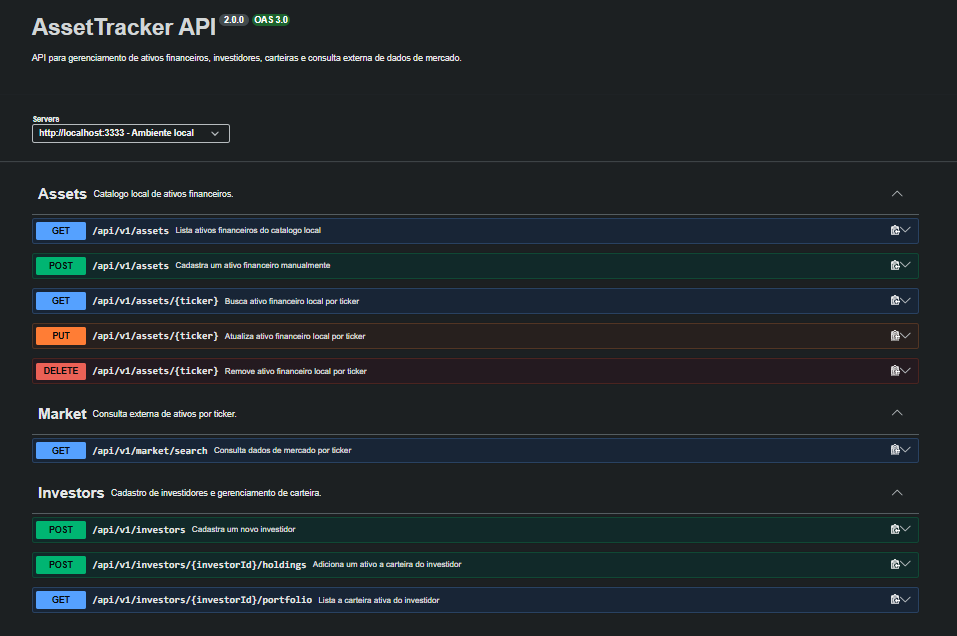
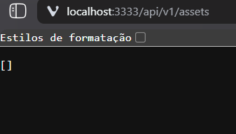
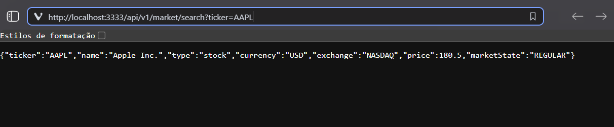
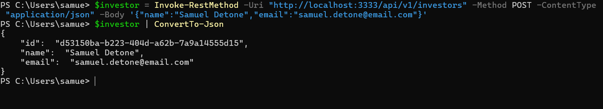
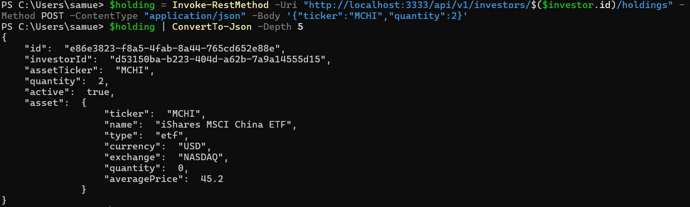
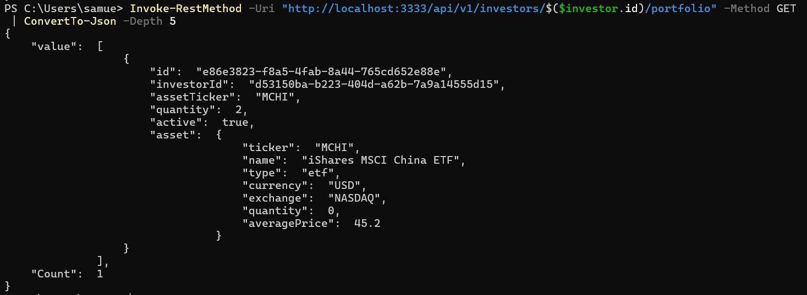
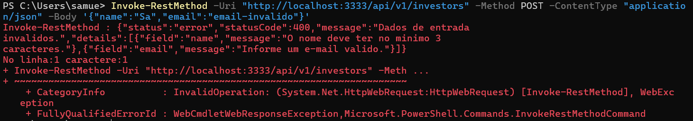
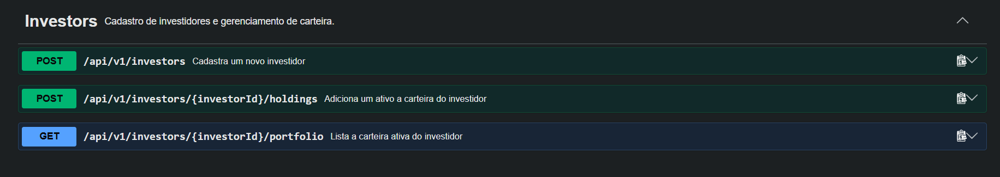

# AssetTracker API

## Entrega 2: persistencia, validacao e integracao externa

Projeto adaptado do dominio Pokemon para carteira de investimentos.



---

## 1. Visao geral da adaptacao

| Proposta original | Adaptacao no AssetTracker |
| --- | --- |
| Pokemon | Ativo financeiro |
| Treinador | Investidor |
| Captura de Pokemon | Adicao de ativo a carteira |
| Time com ate 6 Pokemons | Carteira ativa com ate 6 ativos |
| PokeAPI | Yahoo Finance com fallback local |

---

## 2. Requisitos implementados

- PostgreSQL real com Docker Compose.
- Prisma ORM com migrations e repositories.
- Repositorios Prisma substituindo a memoria sem alterar a camada de dominio.
- Validacao de entrada com Zod.
- Middleware global de erros com AppError.
- Gateway externo com Axios para consulta de dados de mercado.
- Swagger atualizado com os endpoints da Entrega 2.



---

## 3. Consulta externa de mercado

Endpoint equivalente ao `GET /api/v1/pokedex/search?name=pikachu`:

```txt
GET /api/v1/market/search?ticker=AAPL
```



---

## 4. Cadastro de investidor

Endpoint equivalente ao cadastro de treinadores:

```txt
POST /api/v1/investors
```

Exemplo de corpo:

```json
{
  "name": "Samuel Detone",
  "email": "samuel.detone@email.com"
}
```



---

## 5. Adicao de ativo a carteira

Endpoint equivalente a captura de Pokemon:

```txt
POST /api/v1/investors/{investorId}/holdings
```

Exemplo de corpo:

```json
{
  "ticker": "MCHI",
  "quantity": 2
}
```



---

## 6. Listagem da carteira

Endpoint equivalente a listagem do time atual do treinador:

```txt
GET /api/v1/investors/{investorId}/portfolio
```



---

## 7. Validacao e tratamento de erros

Exemplos implementados:

- Payload invalido retorna `400`.
- Registro duplicado retorna `409`.
- Recurso inexistente retorna `404`.
- Falha de banco ou provedor externo retorna `503`.



---

## 8. Funcionalidades diferentes da proposta original

- O dominio foi alterado de Pokemon para investimentos.
- A PokeAPI foi substituida por uma consulta de mercado financeiro.
- A captura de Pokemon virou adicao de ativos a carteira.
- O time de Pokemon virou carteira ativa do investidor.

---

## 9. Funcionalidades adicionais

- Docker Compose com PostgreSQL e Adminer.
- Swagger completo para a Entrega 2.
- Fallback local para a integracao externa.
- Logs HTTP no terminal.
- Tratamento de erros especificos do Prisma.
- Porta `5433` para evitar conflito com outro Postgres local.



---

## 10. Pendencias e observacoes

- O projeto nao usa Pokemons nem PokeAPI porque o dominio foi adaptado.
- O DTO externo nao retorna imagem de Pokemon, mas dados de ativo financeiro.
- O fluxo principal da Entrega 2 foi mantido com outro dominio.
